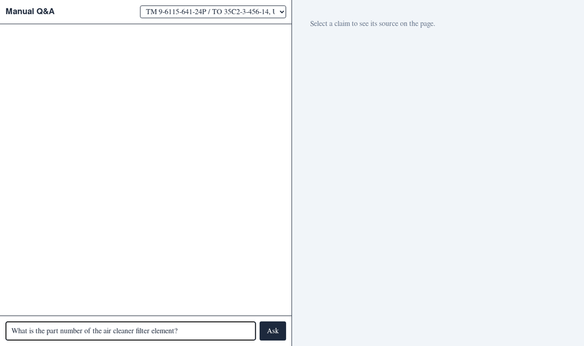

# LLM-Chatbot v2

[](https://www.python.org/downloads/)
[](LICENSE)
[](https://github.com/psf/black)

A question-answering assistant for technical manuals whose core promise is that **the reader can
check every claim against the source while reading the answer**. Each claim is tied to a verbatim quote from a
specific text line, table row or figure, highlighted on the page, and checked before it is shown. A claim that fails
its checks is removed; if none survive, the assistant says it could not find the answer.



*Three live answers recorded on 2026-11-09 and replayed. Highlights are per printed line, so one also covers the next word ("Allow").*

## Result

On 169 held-out questions over three public manuals, registered before the run
([`docs/prereg.md`](docs/prereg.md), tag `prereg`):

| Correct, with the key facts in the cited source | v2 | v1 |
|---|---|---|
| Judge (phi4, majority of 3 repeats) | **0.805** | 0.420 |
| Difference, 95% clustered bootstrap interval | **+0.385** (0.21 to 0.52) | |
| Exact McNemar | 72 items only v2 gets right, 7 only v1; p = 1e-14 | |
| Blind human grading, 50 of those items | 42 of 50 | 31 of 50 |

These questions were written for this project, so there is no outside ranking for this table.

**The judge is harder on v1 than on v2.** In blind grading it wrongly failed 19 of 50 v1 answers against 7 of v2's,
which triggers the registered warning. Most of those were picked because the judge had already rejected them; on the
items drawn at random it agreed with the human grader on 52 of 58. Allowing for those misses, the gap is about 33 points
rather than 38. v2 leads on every reading. Method, repeats, judges and limits: [`evals/results/TEST.md`](evals/results/TEST.md).

**Where v2 still fails** (33 of 169): it declines when the answer is there (11; 4 because its own checks removed every
claim), gives right but incomplete answers (6), answers questions the manuals do not cover (4), and twice its checks
remove a true claim. About 6 failures look like judge errors. Every miss is labelled in
[`evals/results/test/v2-misses.jsonl`](evals/results/test/v2-misses.jsonl).

**What it costs:** about 13 s an answer (p95 22 s) on a 16 GB laptop GPU, against v1's 2-3 s.

**On a public benchmark:** on ViDoRe V3's industrial manuals (5,244 pages of US Air Force technical orders, 283 queries),
v2's retrieval scores NDCG@10 0.567 (0.525 to 0.610): **2nd of 9** in the published text-retrieval table for this corpus
when checked on 2026-11-09, above the text retrievers alone (0.45 to 0.53) and 0.072 behind the best pipeline (0.639). Retrieval only, on the corpus's own text:
[decision 005](docs/decisions/005-external-benchmark.md).

**Not yet tested:** answers on a public benchmark without a paid judge; a manual neither system has seen; whether the
meaning check, which removed nothing on test, earns its place.

## Why v2

v1 was scored first, unchanged, on 42 questions over three public manuals
([`evals/results/NOTES.md`](evals/results/NOTES.md)). The baseline showed that retrieval mostly
works and reading does not:

| v1 (default settings) | Value |
|---|---|
| Recall@5 (a gold page among the 5 retrieved) | 0.89 |
| Answer correctness | 0.49 |
| Correctness on table questions | 0.33 |
| Correctness on figure questions | 0.20 |
| Correctness on the parts manual | 0.03 |

Tables flattened by text extraction wreck answers (one answer gave a CAGE code as a part number: right
row, wrong column), figures are retrieved but unreadable, and the relevance gate drops correct pages.
These answers were graded by Qwen3.8, which v2 also uses as a generator, so before any v1–v2
comparison, v1 is re-graded by an independent judge from another model family.

## What v2 is

Design: [`docs/superpowers/specs/2026-11-01-v2-design.md`](docs/superpowers/specs/2026-11-01-v2-design.md)
(approved after four independent reviews). In short:

- **Parsing with coordinates:** OCR-grade parsing into text lines, tables (cells intact) and figures,
  every box in one page-normalised coordinate system, so highlights land on the rendered page. Scanned
  or malformed pages are always OCR'd.
- **Tables as data:** every table goes into SQLite; a `lookup_table` tool returns the exact row with
  its header.
- **Page images to a vision model** alongside the retrieved text.
- **Claim-level citations, checked:** the model answers one claim per line with a block id and a
  verbatim quote. A claim is shown only if its quote matches the source; numbers and identifiers must
  sit in the column whose header matches. Claims that fail are removed into a "see why" disclosure,
  and if none survive, the assistant says it could not find the answer.
- **Evaluation a sceptical engineer would trust:** a held-out test set split by manual section, one
  pre-registered headline metric with an exact McNemar test and a clustered bootstrap interval, an
  independent judge from a model family that is not among the generators, human checks of gold
  answers and grading, and the misses reported.
- **Plain Python modules behind standard HTTP APIs** (OpenAI-compatible chat, embeddings, rerank), so
  any compatible endpoint works; no orchestration framework.

The build follows [delivery tiers](docs/superpowers/specs/2026-11-01-v2-design.md#delivery-tiers):
a minimum credible version first, planned as a
[sequence of eight plans](docs/superpowers/plans/2026-11-02-tier1-roadmap.md).

## Progress

| Step | State |
|---|---|
| Plans 1–4: coordinate spike, ingestion, answer path, overlay UI | done ([decisions 001](docs/decisions/001-parser-and-coordinates.md), [002](docs/decisions/002-ingestion.md); [M1](docs/m1/README.md)) |
| Plan 5: eval set and judge | done: dev 172, test 169 frozen at tag `eval-test-frozen`, judge phi4 ([decision 003](docs/decisions/003-judge.md)) |
| Plan 6: component selection | done: Qwen3-Reranker-4B, tested on 16 and 32 GB ([decision 004](docs/decisions/004-retrieval.md)) |
| Plan 7: pre-registration and test run | done: [`evals/results/TEST.md`](evals/results/TEST.md) |
| Plan 8: presentation | in progress: this README, `EVAL.md`, demo GIF, external benchmark ([proposal](docs/decisions/005-external-benchmark.md)) |

## Repository layout

```
manualqa/              v2 package
  geometry.py          the one coordinate system (render pages; PDF points and pixels -> [0,1] boxes)
  blocks.py            block schema every parser emits (lines, tables with cells, figures)
  ocr_detect.py        decides per page whether the PDF text layer can be trusted
  overlay.py           draws parses over rendered pages for checking by eye
  parsers/             parser adapters (text layer reference, Docling, PaddleOCR-VL)
evals/
  qa.jsonl             42 dev questions with gold pages and reference answers
  run_eval.py          harness: generate, score (retrieval metrics, LLM judge), summarise
  results/             v1 baseline results and raw answers
  spike/               parser spike: pages, expectations, runner, metrics, report
manuals/               three public manuals (sources and licences in manuals/SOURCES.md)
docs/
  superpowers/specs/   the v2 design
  superpowers/plans/   implementation plans
  spike/               spike overlays and metrics
  decisions/           decision records (what was tried, what won, by how much)
api.py, backend/, frontend/, docker-compose.yaml, scripts/
                       v1 code (scored as the baseline; to be replaced)
```

## Running what exists

Requires Python 3.12 and [uv](https://docs.astral.sh/uv/).

```bash
uv sync --extra dev
uv run pytest tests/ -q                                    # unit tests (GPU parser tests skip)
uv run python -m evals.spike.run_spike --parser textlayer  # spike: parses, overlays, metrics
uv run python -m evals.spike.report docs/spike/*/metrics.json
```

The parser candidates need a GPU and their own optional dependencies; tests that need them run with
`MANUALQA_PARSERS=1`. Reproducing the v1 baseline is described in [`evals/README.md`](evals/README.md).

## Data

The three bundled manuals are US Government publications (an FAA handbook and two Army technical
manuals), chosen because they stress different parts of a pipeline: born-digital prose with charts,
a scan with a letter-spaced text layer, and parts lists paired with exploded views. Sources,
licences and checksums: [`manuals/SOURCES.md`](manuals/SOURCES.md).

## How this is built

The code is written with AI coding agents (Claude Code, Codex, GitHub Copilot CLI) under Alexander
Feht's specification and review. Design decisions, rejected alternatives and every reported number
are committed in this repository.

This project is independently developed by Alexander Feht during personal time using personal
hardware. It is not affiliated with or commissioned by any employer, and was licensed under MIT prior
to any discussions with external parties.
